<div align="center">
  
</div>

# CORS Configuration Auditor

A small, single-target auditor that records the CORS headers returned by one HTTP
GET request. Use it only against an endpoint you are authorized to test.

## Features

- Sends one `Origin` header and reports the returned ACAO, ACAC, and `Vary` headers.
- Uses HTTPS for a bare hostname, verifies TLS certificates, and times out after 10 seconds.
- Does not follow redirects, so the request stays on the explicitly authorized URL.
- Does not send cookies, authorization headers, or other credentials.
- Labels results as observations, not proof of browser access to authenticated data.

The default probe origin is `https://cors-audit.invalid`, a reserved non-resolving
domain suitable only for observing simple reflection behavior. For a meaningful
origin-policy check, use an origin that you control and are authorized to use.
Even a reflected origin with `Access-Control-Allow-Credentials: true` is only a
potential concern here: this tool does not authenticate, issue browser requests,
or verify that sensitive response data is readable.

## Usage

No third-party packages are required (Python 3.10+).

```bash
python main.py https://api.example.test/v1/data
```

The program prompts for authorization against the target URL before probing. To
run non-interactively, provide an explicit non-secret authorization context:

```bash
python main.py --yes --authorization "approved staging audit" \
  --origin https://audit.example.test https://api.example.test/v1/data
```

`--authorization` is not sent to the target or included in JSON output. Avoid
putting credentials in target URLs; URL user information and query strings are
redacted from displayed and exported target values. JSON results can be written
with `-o results.json`.

## Tests

Run the offline test suite with:

```bash
python -m unittest discover -s tests
```
